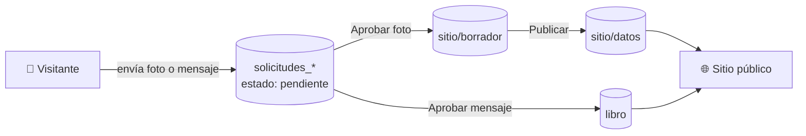

<div align="center">

# 🏛️ Museo Digital CETIS 69

**46 años del CETIS 69 · Ciudad Obregón, Sonora**

Historia, línea del tiempo, recorrido 3D del plantel, archivo fotográfico colaborativo,
libro de visitas, encuestas y un panel de administración con moderación.

<br>


<br><br>

[Características](#caracteristicas) · [Páginas](#paginas) · [Ejecutarlo](#ejecutar) · [Firebase](#firebase) · [Panel admin](#admin) · [Recorrido 3D](#recorrido-3d) · [Seguridad](#seguridad) · [Pendientes](#pendientes)

</div>

---

## 📑 Contenido

| # | Sección | # | Sección |
|:-:|---------|:-:|---------|
| 1 | [✨ Características](#caracteristicas) | 9 | [🏰 Recorrido 3D](#recorrido-3d) |
| 2 | [🗂️ Páginas del sitio](#paginas) | 10 | [📋 Encuestas](#encuestas) |
| 3 | [📁 Estructura y nombres de archivo](#estructura) | 11 | [📴 Modo offline (PWA)](#offline) |
| 4 | [🚀 Cómo ejecutarlo](#ejecutar) | 12 | [🖥️ Modo kiosco](#kiosco) |
| 5 | [🔥 Firebase](#firebase) | 13 | [🔐 Seguridad](#seguridad) |
| 6 | [🧭 Flujo de contenido](#flujo) | 14 | [⚠️ Pendientes](#pendientes) |
| 7 | [🛠️ Panel de administración](#admin) | 15 | [🙌 Créditos](#creditos) |
| 8 | [📝 Editar el contenido](#contenido) | | |

---

<a id="caracteristicas"></a>
## ✨ Características

| | Función | Descripción |
|:-:|---------|-------------|
| 🕰️ | **Línea del tiempo** | Seis hitos (1986 a 2026) con especialidades, docentes e imagen por año. |
| 🔍 | **Búsqueda global** | Lupa del menú o tecla <kbd>/</kbd>. Ignora acentos y mayúsculas, con navegación por teclado. |
| 🖼️ | **Archivo fotográfico** | Galería por década, buscador, visor con anterior y siguiente, y envío de recuerdos. |
| 📖 | **Libro de visitas** | Mensajes moderados por el administrador, filtros por rol y botón "me emociona". |
| 🏆 | **Salón de la fama** | Reconocimientos deportivos y culturales, filtrables. |
| 🎮 | **Recorrido 3D** | Museo navegable en primera persona, con mapa, iluminación por horario y guía. |
| 📋 | **Encuestas** | Formularios con subrayado de opciones, borrador automático y plantilla de papel. |
| 🛡️ | **Panel admin** | Moderación, edición en JSON, borrador y publicación con confirmación. |
| 📱 | **PWA** | Instalable y consultable sin conexión. |
| 🖥️ | **Modo kiosco** | Para pantallas táctiles dentro del plantel. |
| ♿ | **Accesible** | Enlace de salto, roles ARIA, foco visible, soporte de teclado y `prefers-reduced-motion`. |

---

<a id="paginas"></a>
## 🗂️ Páginas del sitio

| Página | Archivo | Qué hace |
|--------|---------|----------|
| 🏠 **Inicio** | `index.html` | Historia, línea del tiempo, oferta, docentes, archivo visual, eventos, proyectos, exalumnos, ciencia y contadores. |
| 🏆 **Salón de la fama** | `salon-fama.html` | Premios desde `datos.json`, con filtro deportivo o cultural. |
| 📷 **Archivo fotográfico** | `archivo-fotografico.html` | Galería aprobada, formulario de envío y visor con navegación. |
| 📖 **Libro de visitas** | `libro-visitas.html` | Mensajes aprobados en tiempo real y formulario de envío. |
| 🏰 **Recorrido 3D** | `mapa-360.html` | Museo 3D con mapa, guía y panel de herramientas para el administrador. |
| 🎓 **Créditos** | `creditos.html` | Equipo, agradecimientos, fuentes y herramientas libres. |
| 🛡️ **Administración** | `admin.html` | Panel restringido con acceso por Google (no está enlazado en el menú). |
| 📋 **Encuestas** | `MuDiCET69.html` | Encuestas públicas y panel de respuestas. |

---

<a id="estructura"></a>
## 📁 Estructura y nombres de archivo

> [!IMPORTANT]
> Las páginas y el service worker esperan **exactamente** estos nombres. Si tus archivos conservan sufijos generados (`_83f247`, `_1`…), renómbralos antes de publicar (tabla desplegable más abajo).

### Estructura final esperada

```text
.
├── index.html
├── salon-fama.html
├── archivo-fotografico.html
├── libro-visitas.html
├── mapa-360.html
├── creditos.html
├── admin.html
├── MuDiCET69.html
├── qr-zonas.html             ⏳ Pendiente (referenciado por sw.js)
│
├── comun.js                  Menú, pie, modal, buscador, kiosco, carga de datos
├── museo.js                  Motor del recorrido 3D (Three.js)
├── museo.css                 Estilos del recorrido 3D
├── puntos.js                 Puntos de información, vitrinas, galerías y guía del 3D
├── mejoras-encuestas.js      Mejoras del módulo de encuestas
├── qrcode.js                 ⏳ Pendiente (referenciado por sw.js)
├── estilos.css               Estilos globales (tema guinda)
├── paginas.css               Estilos de páginas interiores
│
├── datos.json                Todo el contenido editable del sitio
├── sw.js                     Service worker (caché y modo offline)
├── manifest.webmanifest      Manifiesto PWA
│
├── icono-180.png · icono-192.png · icono-512.png     ⏳ Pendientes
├── mapa-museo3D.png          Plano usado por puntos.js (MAPA.imagen)   ⏳ Pendiente
└── museo.glb                 Modelo 3D del plantel                     ⏳ Pendiente
```

<details>
<summary><b>🔁 Tabla de renombrado de archivos recibidos</b> (solo necesaria una vez; bórrala cuando ya estén renombrados)</summary>

<br>

| Archivo recibido | Renombrar a |
|------------------|-------------|
| `index_21826f.html` | `index.html` |
| `archivo-fotografico_8d08b6.html` | `archivo-fotografico.html` |
| `libro-visitas_d6b530.html` | `libro-visitas.html` |
| `salon-fama_1.html` | `salon-fama.html` |
| `creditos_1.html` | `creditos.html` |
| `admin_bd654b.html` | `admin.html` |
| `MuDiCET69.html` | `MuDiCET69.html` *(sin cambio)* |
| `comun_83f247.js` | `comun.js` |
| `museo_1.js` | `museo.js` |
| `museo_1.css` | `museo.css` |
| `mejoras-encuestas_1.js` | `mejoras-encuestas.js` |
| `estilos_1.css` | `estilos.css` |
| `paginas_6fbe3e.css` | `paginas.css` |
| `sw_9ac7a1.js` | `sw.js` |
| `manifest_1.webmanifest` | `manifest.webmanifest` |
| `datos_8eb67e.json` | `datos.json` |
| `puntos.js` | `puntos.js` *(sin cambio)* |
| `mapa-360.html` (o su variante con sufijo) | `mapa-360.html` ⚠️ *no aparecía en la lista original; verifica cómo llegó* |

</details>

---

<a id="ejecutar"></a>
## 🚀 Cómo ejecutarlo

El sitio lee `datos.json` con `fetch()` y usa módulos de Firebase, así que **no funciona con doble clic** (`file://`). Sírvelo por HTTP:

```bash
# Python
python3 -m http.server 8080

# Node
npx serve .
```

Abre <http://localhost:8080/>.

**Para publicarlo**, sirve cualquier hosting estático (GitHub Pages, Netlify, servidor de la escuela). Se necesita **HTTPS** para el service worker, la instalación como app y el inicio de sesión con Google (`localhost` cuenta como contexto seguro, por eso funciona en pruebas locales).

---

<a id="firebase"></a>
## 🔥 Firebase

**Proyecto:** `amprg-28da9`

**Autenticación:** Google (panel admin) y correo y contraseña (recorrido 3D y encuestas).

### Colecciones

| Ruta | Quién escribe | Uso |
|------|---------------|-----|
| `sitio/datos` | Admin (al publicar) | Contenido público. Si existe, **tiene prioridad** sobre `datos.json`. |
| `sitio/borrador` | Admin | Cambios sin publicar. Solo admins. |
| `admins/{correo}` | Admin | Campo `activo: "true"` concede acceso al panel. |
| `solicitudes_archivo` | Visitante | Fotos enviadas. `estado`: `pendiente`, `aprobada`, `rechazada`. |
| `solicitudes_libro` | Visitante | Mensajes del libro. Mismos estados. |
| `libro` | Admin | Mensajes publicados. Los visitantes solo suman *likes*. |
| `mu_encuestas` | Admin (encuestas) | Definición de encuestas y sus respuestas. |

### Reglas de Firestore

> [!WARNING]
> Las reglas deben publicarse en la consola de Firebase. Sin ellas, la seguridad del sitio no existe.

Como mínimo deben cubrir:

- **`admins`**: lectura del propio correo o de un admin; escritura solo admin.
- **`sitio/borrador`**: lectura y escritura solo admin.
- **`solicitudes_*`**: creación pública con validación (`estado == "pendiente"`, `creado == request.time`); lectura y edición solo admin.
- **`libro`**: lectura pública; creación y borrado solo admin; actualización pública únicamente para sumar *likes* en `+1`.

---

<a id="flujo"></a>
## 🧭 Flujo de contenido



1. El visitante envía una foto (se sube a imgBB) o un mensaje. Queda en `pendiente`.
2. El admin revisa en **Solicitudes**. Una foto aprobada entra al **borrador** del archivo; un mensaje aprobado se publica en `libro`.
3. En **Publicar**, el admin revisa los avisos y publica. El sitio público lee `sitio/datos` en tiempo real.

---

<a id="admin"></a>
## 🛠️ Panel de administración

Entra desde `admin.html` con una cuenta de Google registrada en `admins`.

| Pestaña | Función |
|---------|---------|
| 📊 **Resumen** | Contadores, estado de publicación y fotos con imagen por sección. |
| 📥 **Solicitudes** | Aprobar o rechazar fotos y mensajes, con búsqueda. |
| 📖 **Libro publicado** | Tabla de mensajes con *likes* y eliminación. |
| ✏️ **Contenido** | Editor JSON por sección, con validación, formato y descarte. |
| ☁️ **Publicar** | Cambios pendientes, avisos (fotos faltantes, más de 3 fotos extra), descargar o importar `datos.json`, publicar (<kbd>Ctrl</kbd> + <kbd>S</kbd>). |
| 🛡️ **Administradores** | Agregar, activar, desactivar o eliminar accesos. |

> [!NOTE]
> Cada cambio se guarda primero como **borrador**. Nada llega al público hasta que se publica.

---

<a id="contenido"></a>
## 📝 Editar el contenido (`datos.json`)

| Clave | Contenido |
|-------|-----------|
| `sitio` | Menús (`menu`, `menuInicio`), páginas indexadas por el buscador y pie (`pie`). |
| `hitos` | Línea del tiempo: `y`, `t`, `d`, `s` (`[icono, especialidad]`) y docentes (`n`, `m`, `u`, `imgs`). |
| `hitoImagenes` | Imagen de cada año de hitos. |
| `eventos` · `proyectos` | Tarjetas con `u` (foto) e `imgs` (fotos extra). |
| `exalumnos` · `ciencia` | Tarjetas con `n`, `r`, `d`, `u`, `imgs`. |
| `premios` | Salón de la fama. `c`: `d` (deportivo) o `c` (cultural). |
| `archivo` | Galería por década (`d`: 198…202), con `c`, `r`, `t`, `por`, `u`, `imgs`. |
| `zonas` | Zonas del plantel: `id`, `n`, `ic`, `pts`, `etiquetas`, `pano`, `d`, `u`, `imgs`. |
| `creditos` | Equipo, agradecimientos, fuentes e imágenes. |
| `ajustes` | `archivoEndpoint`, `libroEndpoint`, `recorridoSegundos`, `geoMapa`, `caminos`, `kiosco`, `bloqueos`, `museo3d`. |
| `offline` | Archivos extra que el service worker guarda sin conexión. |

### 🖼️ Convención de imágenes

- **`u`**: foto principal (URL `https` o ruta local, por ejemplo `images/archivo/foto.jpg`). Vacío `""` = sin foto.
- **`imgs`**: hasta **3** fotos extra; el visor solo muestra tres.

### 🧩 Ejemplo de tarjeta

```json
{
  "n": "Nombre del exalumno",
  "r": "Profesión · Generación 2005",
  "d": "Qué logró y por qué es motivo de orgullo.",
  "u": "https://i.ibb.co/ejemplo/foto.jpg",
  "imgs": []
}
```

> [!TIP]
> Muchos textos aún son marcadores ("Nombre del docente", "Describe aquí…"). Revísalos antes de publicar; el panel los marca en **Avisos**.

---

<a id="recorrido-3d"></a>
## 🏰 Recorrido 3D (`mapa-360.html`)

**Motor:** Three.js r164 con `GLTFLoader`, `DRACOLoader`, `TransformControls` y `RoomEnvironment`. Carga el modelo `museo.glb`.

### ⌨️ Controles

| Acción | 🖥️ PC | 📱 Táctil |
|--------|-------|-----------|
| Caminar | <kbd>W</kbd> <kbd>A</kbd> <kbd>S</kbd> <kbd>D</kbd> / flechas · <kbd>Shift</kbd> corre | Joystick |
| Mirar | Mouse (clic para capturar) | Arrastrar |
| Información | Apuntar al centro y clic | Tocar |
| Mapa | <kbd>Tab</kbd> | Botón **Mapa** |
| Sentarse (auditorio) | <kbd>E</kbd> junto a una butaca | Botón **Sentarse** |
| Iluminación | <kbd>1</kbd> día · <kbd>2</kbd> atardecer · <kbd>3</kbd> noche | Botones superiores |
| Vuelo | <kbd>F</kbd> | Botón **Vuelo** (con subir y bajar) |
| Sonido | <kbd>M</kbd> | Botón **Sonido** |
| Guía | <kbd>H</kbd> | Botón **?** |
| Pausa | <kbd>Esc</kbd> | Botón **Pausa** |

### 🧱 Contenido (`puntos.js`)

Define los puntos de información (`PUNTOS`), la placa de la Pantera (`PLACA_PANTERA`), las vitrinas (`VITRINAS`), galerías de fotos (`GALERIAS`), bocinas, asientos del auditorio, la guía y los consejos. Los textos marcados con ✏️ deben reemplazarse.

### 🔧 Herramientas de administración

Un panel **Admin** (solo tras iniciar sesión) permite:

- Colocar vitrinas, mover, girar y escalar objetos.
- Cambiar materiales y ajustar luces.
- Medir distancias y tomar fotos.
- Exportar o importar *presets* JSON.

Los cambios se publican a todos los visitantes con **Publicar a todos**.

---

<a id="encuestas"></a>
## 📋 Encuestas (MuDiCET69)

`MuDiCET69.html` usa Firebase (compat) y la colección `mu_encuestas`. `mejoras-encuestas.js` agrega:

- ✅ Subrayado de opciones marcadas (se guarda en el texto de la respuesta).
- 💾 Borrador automático en `localStorage`, con opción de empezar de nuevo.
- 🔗 Copiar enlace y duplicar encuesta desde el panel.
- 📄 Plantilla corta de papel para captura manual.
- 🔎 Buscador en la tabla de respuestas.
- 🙈 Preguntas condicionales que aparecen solo si la respuesta previa lo indica.

### Sintaxis para definir una encuesta

```text
#Sección
u|Pregunta con una sola respuesta*|Opción A;Opción B;Opción C
m|Pregunta de selección múltiple|Opción 1;Opción 2;Otra
c|Pregunta de respuesta corta
```

| Símbolo | Significado |
|:-------:|-------------|
| `u` | Opción única |
| `m` | Selección múltiple |
| `c` | Texto libre |
| `*` al final de la pregunta | Obligatoria |
| `#` | Sección |

---

<a id="offline"></a>
## 📴 Modo offline (PWA)

`sw.js` usa dos estrategias:

| Tipo de recurso | Estrategia |
|-----------------|------------|
| HTML, CSS, JS, JSON y manifiesto propios | 🌐 **Red primero** (espera de 4 s), con respaldo en caché |
| Imágenes, fuentes y recursos externos | 💾 **Caché primero**, actualizando en segundo plano |

El service worker **no cachea** Firestore, Auth ni `admin.html`.

> [!IMPORTANT]
> Al publicar cambios, **sube `VERSION` en `sw.js`** (actualmente `museo-cetis69-v2`). Así los navegadores descargan la nueva caché.

---

<a id="kiosco"></a>
## 🖥️ Modo kiosco

| URL | Efecto |
|-----|--------|
| `…/?kiosco=1` | Activa el modo (se guarda en el navegador). |
| `…/?kiosco=0` | Lo desactiva. |

Tras `ajustes.kiosco.segundosInactividad` segundos (90 por defecto) sin uso, se cierran modales y el buscador, se sale de pantalla completa y se regresa al inicio.

---

<a id="seguridad"></a>
## 🔐 Seguridad

| | Aspecto | Detalle |
|:-:|---------|---------|
| 🔑 | **Configuración de Firebase** | Es pública por diseño; la seguridad depende de las reglas de Firestore. |
| ⚠️ | **Clave de imgBB** | Está en el código del navegador y cualquiera puede verla. **Recomendado:** revocarla y subir las fotos mediante una Cloud Function que guarde la clave en el servidor. |
| 🛡️ | **Acceso al panel** | Se controla con `admins`, pero la protección real está en las reglas. Revisa que estén publicadas. |
| 🧼 | **Contenido sin escapar** | Los textos de `datos.json` se insertan en la página sin escapar en algunos lugares. Es aceptable mientras solo edite el administrador; **no alimentes ese contenido con texto de visitantes**. |

---

<a id="pendientes"></a>
## ⚠️ Pendientes

### 🔴 Seguridad

- [ ] **Clave de imgBB expuesta** en el cliente (ver [Seguridad](#seguridad)).
- [ ] **Reglas de Firestore** sin confirmar como publicadas.

### 🟠 Bloquean funcionamiento

- [ ] **Modelo 3D:** `museo.glb` y `mapa-museo3D.png` deben existir en la raíz. Sin ellos el recorrido no carga.
- [ ] **Archivos faltantes:** `qr-zonas.html`, `qrcode.js`, `icono-180.png`, `icono-192.png` e `icono-512.png` están referenciados en `sw.js` o en el manifiesto, pero no se recibieron. Sin `qr-zonas.html` y `qrcode.js`, el service worker no podrá cachearlos.

### 🟡 Contenido y mantenimiento

- [ ] **Textos marcadores** en `datos.json`, `puntos.js` y `archivo` ("Describe aquí…", "Nombre del docente").
- [ ] **Errores de captura en créditos:** "Jose" / "José" Diego Madrid Leyva y "Direccción escolar".
- [ ] **Zonas en `datos.json`:** ahora el mapa es 3D. Confirma si `zonas` sigue usándose en alguna página; si no, puede eliminarse para aligerar el archivo.
- [ ] **Archivos pesados:** la portada de `index.html` va embebida en base64 (~277 KB). Conviene moverla a un archivo de imagen.

### ✅ Resuelto

- [x] Nombre de la página de inicio: `sw.js` y `comun.js` ya usan `index.html`.

---

<a id="creditos"></a>
## 🙌 Créditos

| Rol | Persona |
|-----|---------|
| 👩‍🏫 **Coordinación del proyecto** | Gabriela Herrera Vilchis |
| 💻 **Investigación histórica y desarrollo web** | José Diego Madrid Leyva (5AMPRG) |
| 📸 **Fotografía** | Dirección escolar, CETIS 69 |

Detalle de fuentes y agradecimientos en [`creditos.html`](creditos.html).

---

<div align="center">

<sub>© 2026 CETIS 69 · Ciudad Obregón, Sonora · Todos los derechos reservados</sub>

</div>
